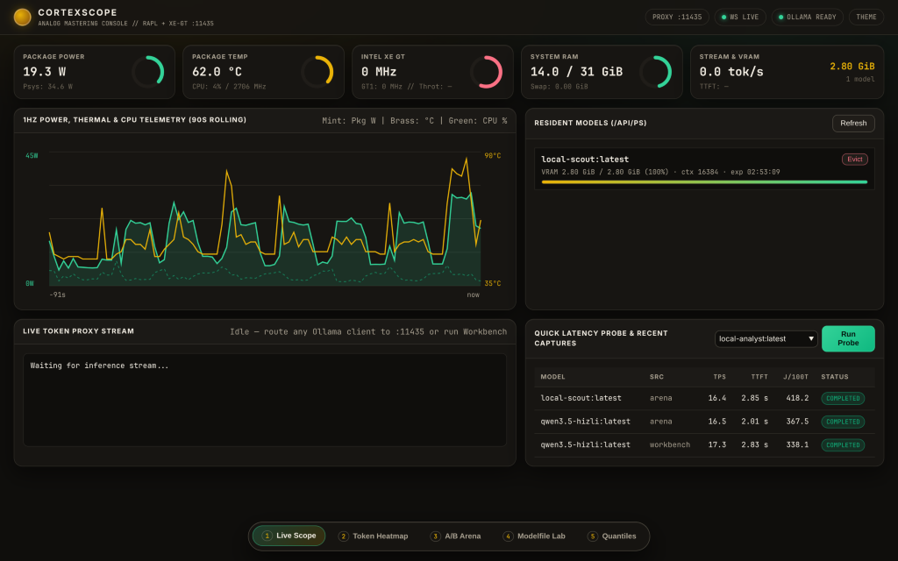
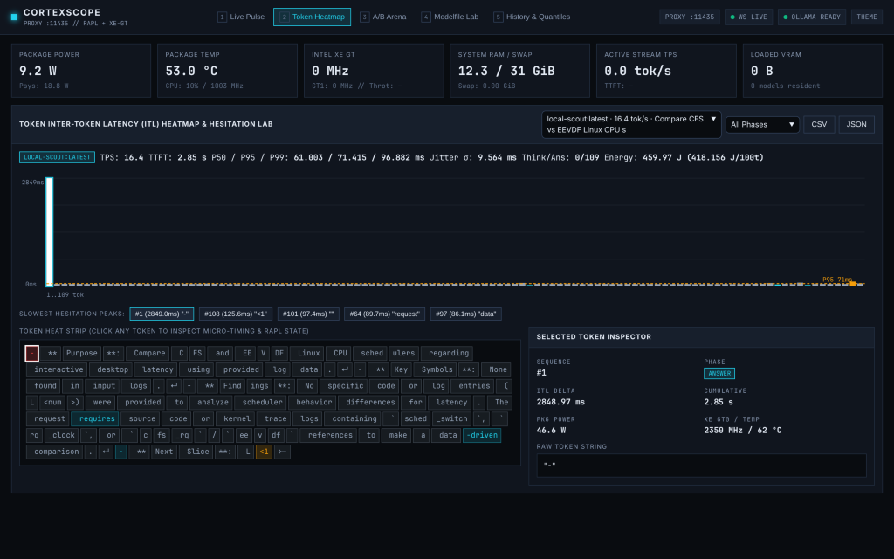
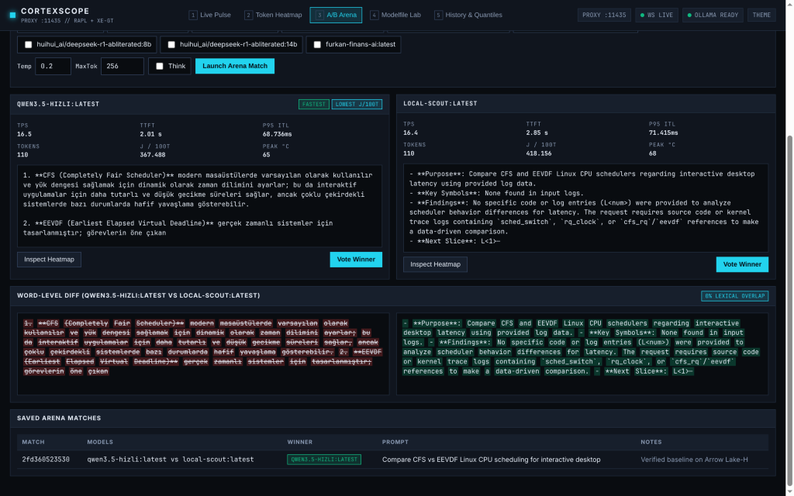
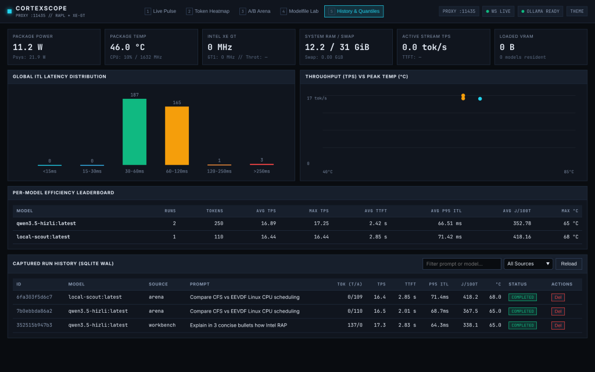

# CortexScope

Local-first LLM cognitive, token micro-latency (ITL/TTFT), and Linux hardware energy (**Intel RAPL + thermal + Intel `xe` GT**) telemetry HUD and transparent Ollama reverse proxy.

## Architecture

```
  Ollama CLI / SDK / OpenAI Client (OLLAMA_HOST=http://127.0.0.1:11435)
         │
         ▼  POST /api/chat | /api/generate | /v1/chat/completions
┌──────────────────────────────────────────────────────────────────────┐
│  CortexScope Reverse Proxy & Telemetry HUD (:11435)                  │
│  ├─ Zero-buffer chunk pass-through -> upstream Ollama (:11434)      │
│  ├─ StreamRunTracker: TTFT, per-token ITL, think/answer split        │
│  ├─ HardwareSampler: intel-rapl energy_uj, x86_pkg_temp, xe GT MHz   │
│  ├─ SQLite WAL: runs, token_events, arena_matches, hw_samples        │
│  └─ WebSocket /ws/telemetry -> 5-View Command Center HUD (/)         │
└──────────────────────────────────────────────────────────────────────┘
```

## HUD Showcase (Real Captured Screenshots)

| Live Pulse & 1Hz Hardware Telemetry | Token Latency Heatmap & Hesitation Inspector |
|---|---|
|  |  |

| Sequential Non-Contended A/B Arena | History, Leaderboard & Quantile Scatter |
|---|---|
|  |  |

## Core Capabilities

1. **Transparent Streaming Proxy (`:11435` → `:11434`)**
   - Captures `/api/chat`, `/api/generate`, and `/v1/chat/completions` (NDJSON & SSE) without buffering lag.
   - Splits `<think>...</think>` and structured `thinking` streams cleanly from final answer tokens.
   - Records aborted connections (`status="aborted"`) cleanly if a client disconnects mid-generation.
2. **Real Linux Energy & Silicon Correlation**
   - Reads `/sys/class/powercap/intel-rapl:*` (`package-0`, `core`, `uncore`, `psys`) with `max_energy_range_uj` wraparound math (`rapl_delta_uj`) to compute exact `pkg_joules`, `psys_joules`, `avg_pkg_watts`, and **`joules_per_100tok`**.
   - Tracks `x86_pkg_temp` / `coretemp` thermal zones, Intel `xe` DRM `gt0`/`gt1` frequencies & throttle state, and `psutil` CPU/RAM/swap.
3. **5-View Command Center HUD (`/`)**
   - **`[1]` Live Pulse:** 1Hz Watts/Temp/CPU Canvas chart, resident `/api/ps` VRAM/RAM split + one-click Evict, live colored token stream, Quick Probe runner.
   - **`[2]` Token Heatmap:** Clickable per-token ITL heat strip, phase filter (`All`/`Think`/`Answer`), Top-5 Slowest Hesitation Peak jump buttons, Token Timeline Canvas, Token Inspector, CSV/JSON export.
   - **`[3]` A/B Model Arena:** Sequential non-contended runs across 2–4 models, Fastest & Lowest-J/100tok badges, lexical LCS Word Diff, and persistent match voting.
   - **`[4]` Modelfile Lab:** Live `/api/show` Modelfile/template/parameter inspector, real-time Context Budget & KV pressure gauge, sampling sliders.
   - **`[5]` History & Quantiles:** Searchable/filterable SQLite WAL run table, per-model efficiency leaderboard, ITL latency histogram, and TPS vs Temp °C scatter chart.

## HTTP & WebSocket API Reference

| Endpoint | Method | Purpose |
|---|---|---|
| `/` | `GET` | 5-view Swiss Technical Telemetry HUD |
| `/ws/telemetry` | `WS` | Live `hello`, `hw_tick`, `run_start`, `token_chunk`, `run_complete`, `arena_progress` stream |
| `/cx/health` | `GET` | Proxy port, upstream status, detected hardware capabilities |
| `/cx/telemetry/now` | `GET` | Latest hardware snapshot, 90–1000s history, loaded `/api/ps` models |
| `/cx/models` | `GET` | Merged `/api/tags` + active VRAM residency |
| `/cx/models/show?name=...` | `GET` | Live Modelfile, template, parameters, architecture metadata |
| `/cx/models/unload` | `POST` | Evict resident model (`keep_alive: 0`) |
| `/cx/runs` & `/cx/runs/{id}` | `GET`/`DELETE` | Filtered run history, full per-token event timeline, cascade delete |
| `/cx/runs/{id}/export?format=csv\|json` | `GET` | Formula-injection safe CSV or JSON export |
| `/cx/workbench/run` | `POST` | Execute & profile a prompt with custom sampling parameters |
| `/cx/arena/run` & `/cx/arena/{id}/vote` | `POST` | Run sequential A/B model comparison and save winner vote |
| `/cx/stats` | `GET` | Per-model aggregated TPS/TTFT/P95/Energy leaderboard & ITL histogram |
| `/api/*`, `/v1/chat/completions` | `POST`/`GET` | Transparent Ollama & OpenAI-compatible proxy routes |

## Quick Start

```bash
make install
cortexscope serve --host 127.0.0.1 --port 11435 --upstream http://127.0.0.1:11434 --open
```

Route any client through the proxy:

```bash
OLLAMA_HOST=http://127.0.0.1:11435 ollama run qwen3.5-hizli:latest
```

Optional systemd user service (`~/.config/systemd/user/cortexscope.service`):

```bash
make install-service
```

## Verification

```bash
make test
# Runs:
#   node --test tests/frontend.test.mjs
#   python3 -m pytest -v
```
