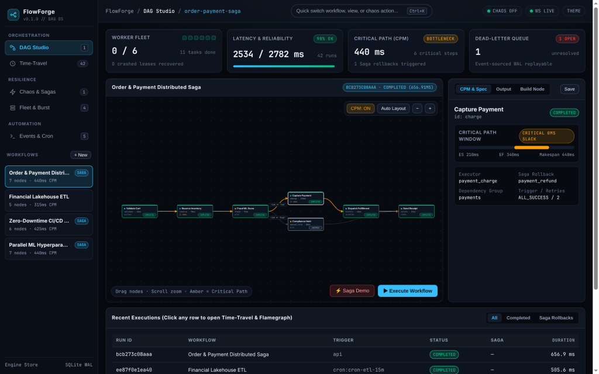
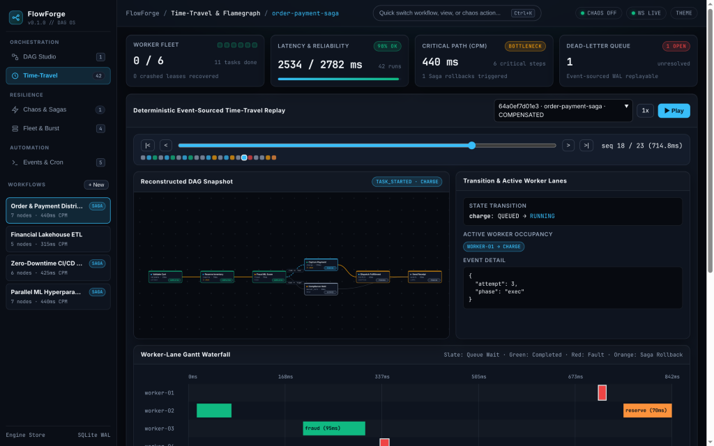
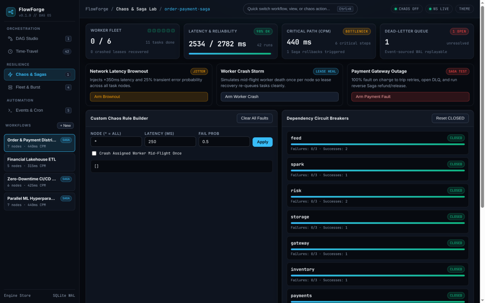
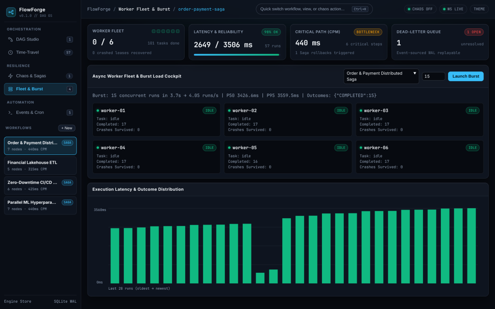
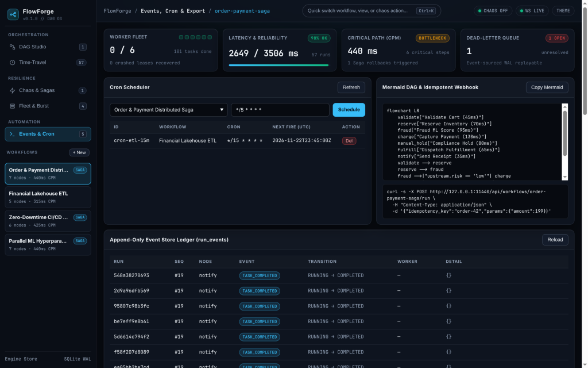

# FlowForge

**Deterministic Distributed-Style DAG Workflow Engine, Saga Orchestrator, Chaos Engineering Lab & Millisecond Time-Travel Observatory.**

FlowForge combines event-sourced SQLite WAL durability, Tarjan SCC cycle validation, Critical Path Method (CPM) scheduling, reverse-topological Saga rollbacks, dependency Circuit Breakers, Chaos fault injection, and a zero-dependency interactive Observatory UI.

## Architecture

```
  Web Studio / REST / Cron / Webhook Trigger (Idempotency Key enforced)
         │
         ▼
┌─────────────────────────────────────────────────────────────────────────┐
│  DAG Compiler (graph.py)                                                │
│  ├─ Tarjan SCC cycle detection + Sugiyama layered topology layout       │
│  ├─ Critical Path Method (ES/EF/LS/LF, zero-slack bottleneck highlight) │
│  └─ AST-only branch condition evaluator (zero eval(), dunder-blocked)   │
└────────────────────────────────────┬────────────────────────────────────┘
                                     ▼
┌─────────────────────────────────────────────────────────────────────────┐
│  Async Worker Fleet & Resilience Core (engine.py + resilience.py)       │
│  ├─ N leased worker lanes with heartbeats + crash lease recovery        │
│  ├─ Token-Bucket rate limiter + CLOSED/OPEN/HALF_OPEN circuit breakers  │
│  ├─ Exponential jittered backoff + Dead-Letter Queue (DLQ) one-click     │
│  └─ Reverse-topological Saga Rollback on downstream failure             │
└────────────────────────────────────┬────────────────────────────────────┘
                                     ▼
┌─────────────────────────────────────────────────────────────────────────┐
│  Append-Only Event Store (storage.py, SQLite WAL) + WebSocket Hub       │
│  └─ `run_events` monotonic seq ledger -> millisecond Time-Travel Replay │
└─────────────────────────────────────────────────────────────────────────┘
```

## Observatory Screenshots (Real Chromium Captures)

| Interactive DAG Studio & CPM Canvas | Millisecond Time-Travel & Gantt Flamegraph |
|---|---|
|  |  |

| Chaos Engineering, Breakers & DLQ | Async Worker Fleet & Burst Benchmark |
|---|---|
|  |  |

| Append-Only Event Store, Cron & Mermaid Export |
|---|
|  |

## Key Engineering Highlights

1. **Poka-Yoke DAG Compiler & Safe AST Evaluator:**
   - Rejects multi-node cycles and self-loops at API boundary (`400 Bad Request` with exact cycle path via Tarjan SCC).
   - Evaluates conditional branches (`upstream.risk == 'high'`) via restricted Python `ast` traversal (`Call`, `__dunder__`, `Import` structurally impossible).
   - Validates outbound webhook URLs against SSRF (blocks link-local metadata `169.254.169.254`, private ranges, `file://`).
   - Enforces allowlisted binaries + `shell=False` + hard subprocess timeouts in `shell_safe`.
2. **Distributed Patterns Built From Scratch:**
   - **Idempotency Keys:** `UNIQUE` constraint at the SQLite boundary returns `409 Conflict` with `existing_run_id`.
   - **Reverse-Topological Saga Rollback:** Downstream failures halt forward edges and walk completed nodes in reverse topological order (`COMPENSATING` → `COMPENSATED`).
   - **Deterministic Event Sourcing & Time-Travel:** Every state transition appends an immutable sequence row to `run_events`, allowing exact topology & worker reconstruction at any historical `seq`.
   - **Chaos Fault Injection & Worker Crash Recovery:** Inject latency spikes, probabilistic failures, or simulated mid-flight worker crashes and watch lease recovery re-queue tasks onto healthy workers.

## Quick Start

```bash
make install
flowforge serve --host 127.0.0.1 --port 11440 --workers 6 --open
```

## Verification

```bash
make test
# node --test tests/frontend.test.mjs  (5/5 pure DAG/flamegraph/XSS tests)
# python3 -m pytest -v                 (12/12 graph, resilience, replay, saga & API/WS tests)
```
