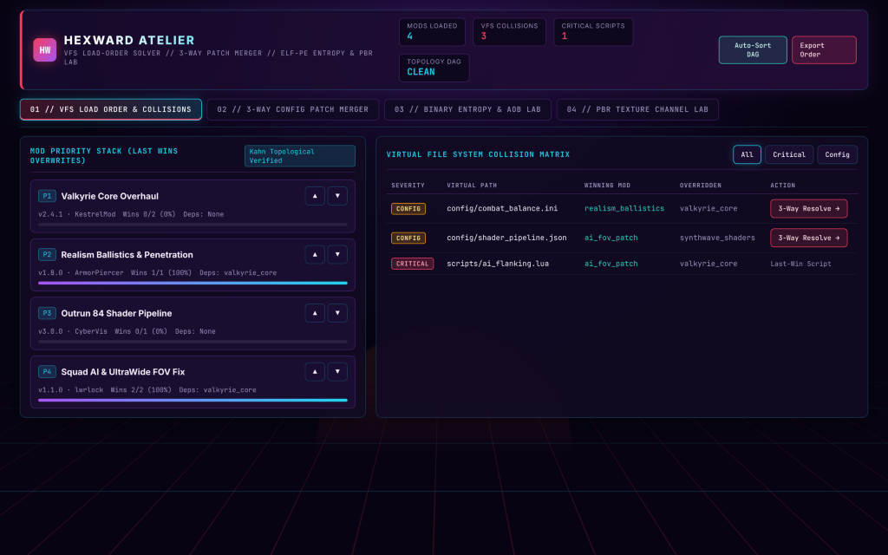
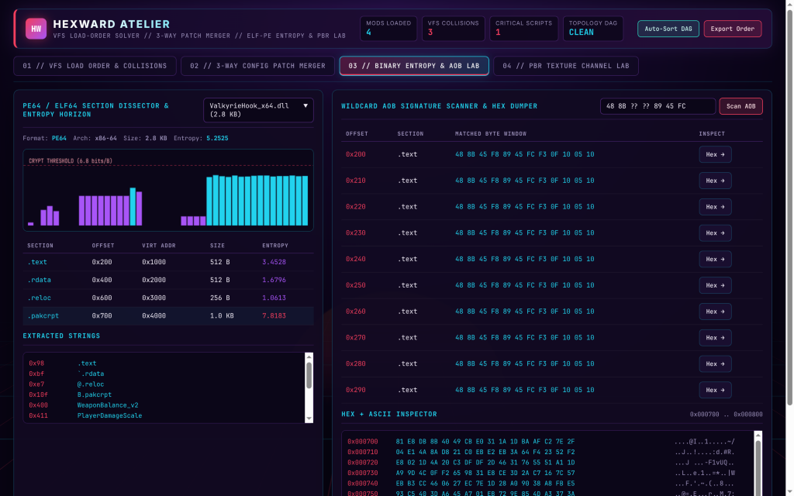
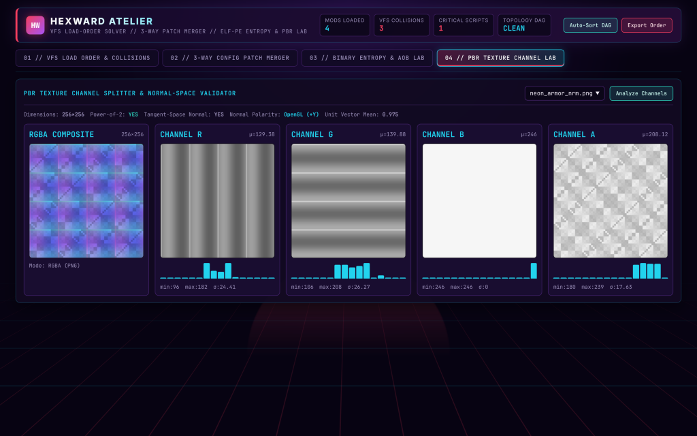

# HexWard Atelier

> **Game Modding VFS Load-Order Conflict Solver, 3-Way Config Patch Merger, ELF64/PE64 Entropy & AOB Dissector, and PBR Texture Channel Lab** wrapped in an Outrun Synthwave Horizon UI.

## Workbench Previews

### 1. VFS Load-Order Priority Stack & Collision Matrix


### 2. PE64 / ELF64 Shannon Entropy Horizon, Wildcard AOB Scanner & Hex Inspector


### 3. PBR Texture RGBA Channel Splitter & Tangent-Space Normal Validator


## Core Engineering Features

1. **VFS Load-Order Solver & Topological Dependency Checker (`src/hexward/conflicts.py`)**
   - Tracks prioritized mod layers (`last wins`), calculates per-mod dominance percentages, and classifies path collisions as `CRITICAL` (`.lua`, `.dll`, `.so`, `.pak`), `CONFIG` (`.ini`, `.json`, `.toml`), or `ASSET` (`.png`, `.dds`).
   - Validates `requires` dependency DAGs using **Kahn's topological sort** (`Auto-Sort DAG`) with cycle detection.

2. **Semantic 3-Way INI & JSON Patch Merger (`src/hexward/conflicts.py`)**
   - Compares `(Vanilla Base, Mod A / Ours, Mod B / Theirs)` at section+key / leaf-path granularity.
   - Auto-merges non-overlapping edits and exposes per-key conflict resolution cards (`Keep Ours`, `Take Theirs`, `Keep Base`) with live patched output generation.

3. **PE64 / ELF64 Binary Dissector, Entropy Horizon & AOB Scanner (`src/hexward/dissector.py`)**
   - Parses real PE32/PE32+ (`MZ` + `PE\0\0`) COFF sections and ELF32/ELF64 (`\x7fELF`) section headers (`e_shoff`).
   - Computes sliding-window **Shannon Entropy** (`0.0 – 8.0 bits/byte`) to highlight packed/encrypted regions (`>= 6.8` threshold), extracts printable ASCII strings, runs wildcard **Array-of-Bytes (`AOB`) signature scans** (e.g. `48 8B ?? ?? 89 45 FC`), and renders section-linked Hex + ASCII dumps.

4. **PBR Texture Channel Lab (`src/hexward/textures.py`)**
   - Splits textures into `RGBA COMPOSITE`, `R`, `G`, `B`, and `A` grayscale previews with 16-bin intensity histograms, min/max/std stats, power-of-two compliance, and OpenGL (`+Y`) vs DirectX (`-Y`) normal-map sanity checks.

## API Endpoints (`src/hexward/app.py`)

| Method | Endpoint | Purpose |
| :--- | :--- | :--- |
| `GET` | `/api/workspace/scan` | Scans mods, VFS collisions, dependency DAG, binaries, and textures |
| `POST` | `/api/mods/reorder` | Applies custom mod load-order and recomputes collisions |
| `POST` | `/api/mods/auto-sort` | Reorders mods using Kahn topological dependency sort |
| `POST` | `/api/merge/three-way` | Performs semantic 3-way INI/JSON merge with conflict overrides |
| `GET` | `/api/binary/dissect` | Parses binary sections, Shannon entropy profile, strings, and initial hex window |
| `GET` | `/api/binary/hex` | Returns offset-bounded 16-byte Hex + ASCII dump rows |
| `POST` | `/api/binary/aob-scan` | Scans binary buffer for hex patterns supporting `??` wildcards |
| `GET` | `/api/textures/inspect` | Splits texture channels and reports tangent-space normal diagnostics |
| `GET` | `/api/report/load-order` | Exports resolved load-order manifest as JSON |

## Quick Start & Tests

```bash
pip install -e .
hexward serve --host 127.0.0.1 --port 11460 --open
```

Run tests (`node --test` + `pytest`):

```bash
make test
```
